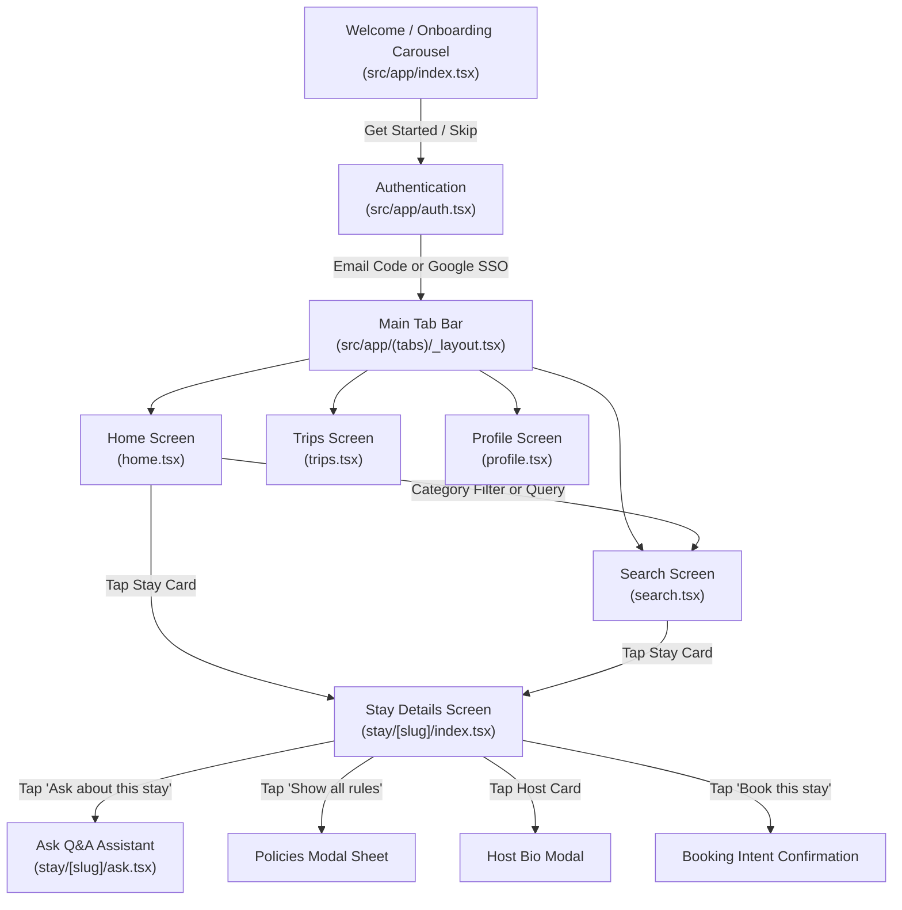
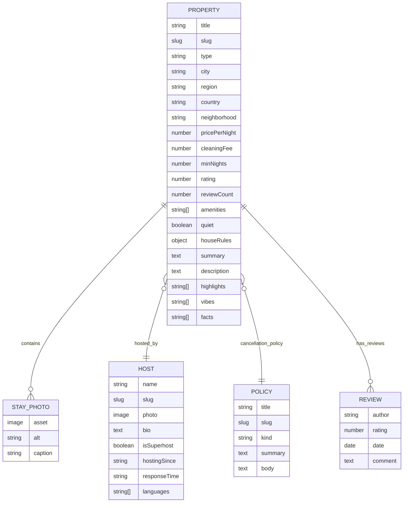

# 🌍 Roam — Project Specification & Architecture Guide

Welcome to the definitive documentation for **Roam**, a modern, cross-platform travel stay application built for travelers seeking unforgettable vacation rentals, cabins, villas, and beach retreats.

---

## 📌 1. Project Overview & Brand Vision

- **Application Name:** Roam (`roam1`)
- **Tagline:** *"Find unforgettable stays for every kind of trip"* / *"A little more room to roam"*
- **Type:** Cross-platform Mobile Application (iOS, Android, Web) + Headless Content Management System (CMS)
- **Primary Objective:** Provide a seamless, high-aesthetic vacation stay discovery and booking experience, pairing natural language search, upfront rule transparency ("Good to know"), and an in-stay verified Q&A assistant ("Ask about this stay").

### Brand & Design Personality
- **Tone:** Welcoming, optimistic, clear, and relaxed.
- **Palette:** Warm sunny yellow action colors paired with soft lavender supporting accents, crisp ink typography, and soothing neutral background surfaces.
- **Visual System:** Generous corner rounding (24px cards, full pill buttons), glassmorphic tab bars and overlays, and custom lightweight geometric SVG icons.

---

## 🛠️ 2. Technology Stack & Platform Ecosystem

### Frontend Mobile Application (`roam1`)
| Layer | Technology | Version | Purpose |
| :--- | :--- | :--- | :--- |
| **Framework** | **Expo** | `^57.0.31` | Universal React Native development platform |
| **Runtime** | **React** | `19.2.3` | UI component tree with React 19 architecture |
| **Native Core** | **React Native** | `0.86.3` | Cross-platform mobile foundation |
| **Routing** | **Expo Router** | `~57.0.29` | File-based, typed routing (`src/app/`) |
| **Native Tabs** | `expo-router/unstable-native-tabs` | SDK 57 | Native platform tab navigation with SF Symbols & Material Icons |
| **Styling** | **NativeWind** & **Tailwind CSS** | `5.0.0-rc.0` / `4.1.12` | Utility-first styling adapted for React Native |
| **CSS Engine** | **LightningCSS** & **PostCSS** | `1.30.1` / `8.5.31` | Lightning-fast CSS compilation |
| **Animations** | **React Native Reanimated** | `4.5.1` | 60+ FPS native gesture & layout animations |
| **Gestures** | **React Native Gesture Handler** | `~2.32.0` | Declarative gesture management & swipe recognition |
| **Vector Graphics** | **React Native SVG** | `15.15.4` | Custom vector icons and curved SVG card headers |
| **Image Pipeline** | **Expo Image** | `~57.0.5` | High-performance image caching, smooth fades, and aspect ratio handling |
| **Typography** | `@expo-google-fonts/manrope` | `^0.4.2` | Manrope geometric sans-serif (400, 500, 600, 700, 800) |
| **Safe Areas** | `react-native-safe-area-context` | `~5.7.0` | Notch and home indicator handling |
| **Authentication** | **@clerk/expo** | `^4.14.0` | User authentication, token caching, email code verification & Google SSO |
| **Analytics & Telemetry** | **PostHog React Native** | `^4.83.0` | Behavioral event tracking, feature flags, session telemetry & error autocapture |

### Backend CMS & Content Infrastructure (`roam1/roam`)
| Component | Technology | Version | Purpose |
| :--- | :--- | :--- | :--- |
| **Content Studio** | **Sanity Studio** | `^6.20.0` | Headless real-time structured content management system |
| **Query Language** | **GROQ** | Sanity v6 | Graph-Relational Object Queries for fast, customized JSON payloads |
| **Tooling & CLI** | `@sanity/cli`, `@sanity/vision` | `^6.20.0` | Interactive schema testing, GROQ query workbench, and migrations |
| **Seeding Engine** | Custom TypeScript Seeder | Node / Sanity CLI | Automated upsert of verified stay properties, hosts, and platform policies |

---

## 🗂️ 3. Repository Architecture & Directory Tree

```
roam/
├── project.md                          # Comprehensive project documentation (this file)
└── roam1/                              # Main workspace root
    ├── app.config.ts                   # Dynamic Expo configuration (PostHog tokens, app slugs)
    ├── app.json                        # Static Expo configuration (plugins, icons, scheme, splash)
    ├── design_system.md                # UI Design Tokens, Color Palettes & Accessibility Rules
    ├── package.json                    # Mobile app dependencies and lifecycle scripts
    ├── global.css                      # Tailwind / NativeWind theme configuration and custom classes
    │
    ├── src/                            # Mobile Application Source Code
    │   ├── app/                        # Expo Router File-Based Route Tree
    │   │   ├── _layout.tsx             # Root layout: ClerkProvider, PostHog, Font loading, Root Stack
    │   │   ├── index.tsx               # Onboarding Screen: Interactive 3-slide hero carousel
    │   │   ├── auth.tsx                # Authentication Screen: Sign up, verify email code, sign in, Google SSO
    │   │   ├── (tabs)/                 # Main authenticated application tabs
    │   │   │   ├── _layout.tsx         # Native tab bar configuration (iOS/Android native symbols)
    │   │   │   ├── _layout.web.tsx     # Web fallback: Glassmorphic bottom navigation bar
    │   │   │   ├── home.tsx            # Home Screen: Category filters, search input, stay listings
    │   │   │   ├── search.tsx          # Search Screen: NLP query parsing, sorting, filter chips, results
    │   │   │   ├── trips.tsx           # Trips Screen: Planned journeys and future itinerary placeholder
    │   │   │   └── profile.tsx         # Profile Screen: User info, active email, and sign out
    │   │   └── stay/                   # Stay Detail Dynamic Routes
    │   │       └── [slug]/
    │   │           ├── index.tsx       # Stay Details: Photo gallery, pricing, Good to Know, Host, Policies
    │   │           └── ask.tsx         # "Ask about this stay": Interactive Q&A chat assistant
    │   │
    │   ├── components/                 # Reusable UI Component Library
    │   │   ├── roam-ui.tsx             # LineIcon (custom SVGs), PressableFeedback, PropertyCard
    │   │   └── ui/                     # Primitives (button.tsx, filter-chip.tsx, surface.tsx, text.tsx)
    │   │
    │   ├── data/                       # Local Mock & Offline Data
    │   │   └── properties.ts           # Fallback properties, amenities, and category definitions
    │   │
    │   ├── hooks/                      # Custom React Hooks
    │   │   ├── use-home-stays.ts       # Hook for fetching and caching category-filtered home listings
    │   │   ├── use-search-stays.ts     # Hook for executing structured and text-based property searches
    │   │   └── use-stay.ts             # Hook for fetching single stay details and host/policy graphs
    │   │
    │   └── lib/                        # Business Logic, Utilities, and Integrations
    │       ├── ask.ts                  # Keyword matching and answer resolution for "Ask about this stay"
    │       ├── favorites.ts            # Reactive in-memory favorites store (useSyncExternalStore)
    │       ├── posthog.tsx             # PostHog client initialization and root provider
    │       ├── posthog-logs.ts         # Telemetry utility helpers
    │       ├── stay-details.ts         # Formatting helpers (pricing math, dates, house rule lines)
    │       ├── stays.ts                # TypeScript interfaces and contracts for Stays, Hosts, and Policies
    │       ├── sanity/                 # Sanity Client & GROQ Query Definitions
    │       │   ├── config.ts           # Sanity project ID, dataset, API version configuration
    │       │   ├── fetch.ts            # Fetch wrapper with network error handling and fallbacks
    │       │   └── queries.ts          # Optimized GROQ queries for home stays and stay details
    │       └── search/                 # Natural Language Search Engine
    │           ├── parse.ts            # NLP query parser (extracts location, price, amenities, type, pets)
    │           └── query.ts            # Filter matching, sorting algorithms, and chip tag builders
    │
    ├── prompts/                        # Architectural Prompts & Historical Project Milestone Specs
    │   ├── 01-nativewind.md            # NativeWind setup spec
    │   ├── 02-design-system.md         # Design system tokens and foundational components
    │   ├── 03-onboarding.md            # Onboarding screen specification
    │   ├── 04-auth-screens.md          # Authentication UI layouts
    │   ├── 05-clerk-auth.md            # Clerk SDK integration spec
    │   ├── 06-homo-and-search.md       # Home screen & search UI specs
    │   ├── 07-content-model.md         # Sanity Studio content model & schema architecture
    │   ├── 08-serach-result.md         # Search results, filter chips, and sorting
    │   ├── 09-stay-details.md          # Property detail screen spec
    │   ├── 10-ask-about-stay.md        # "Ask about this stay" Q&A chat engine
    │   ├── 11-good-to-know.md          # "Good to know" essential rules card spec (UX optimization)
    │   ├── 12-server-search.md         # Server-side search & Sanity GROQ query integration
    │   ├── changes.md                  # Funnel diagnosis & PostHog session analysis
    │   └── post1                       # 20-session guest telemetry simulation log
    │
    └── roam/                           # Sanity Studio Headless CMS
        ├── package.json                # Sanity studio dependencies
        ├── sanity.config.ts            # Sanity Studio configuration (plugins, project setup)
        ├── sanity.cli.ts               # Sanity CLI configuration
        ├── structure.ts                # Custom desk hierarchy structure
        ├── schemaTypes/                # Content Type Schemas
        │   ├── index.ts                # Schema registry export
        │   ├── property.ts             # Property schema (stays, prices, rules, locations, vibes)
        │   ├── host.ts                 # Host schema (name, bio, isSuperhost, responseTime, languages)
        │   ├── policy.ts               # Policy schema (cancellation, refunds, damage, house rules)
        │   ├── review.ts               # Review schema (ratings, feedback, authors)
        │   └── stayPhoto.ts            # Photo schema with captions and layout coordinates
        ├── scripts/
        │   └── seed.ts                 # CLI seed runner with differential upsert logic
        └── seed/                       # Content Seed Datasets
            ├── hosts.ts                # Curated host records
            ├── policies.ts             # Platform and house policies
            └── stays.ts                # Full property listing seed records
```

---

## 🎨 4. Design System & Visual Foundations

The Roam design language is defined in [`design_system.md`](./roam1/design_system.md) and [`src/global.css`](./roam1/src/global.css).

### Color Tokens
| Token | Hex Value | Application |
| :--- | :--- | :--- |
| `roam-primary` | `#FFC629` / `#FFB000` | Primary CTA buttons, active tab indicators, major actions |
| `roam-lavender`| `#C9B4FF` / `#B291F5` | Selected filter chips, active indicators, soft informational tags |
| `roam-ink`     | `#111116` / `#0B0B1A` | Primary typography, headers, high-contrast buttons |
| `roam-muted`   | `#68728B` / `#85879A` | Secondary descriptions, captions, subtle metadata |
| `roam-surface` | `#FFFFFF`             | Card backgrounds, modal sheets, popovers |
| `roam-surface-muted` | `#F4F5F7`       | Inactive filter chips, secondary card panels |
| `roam-app-background` | `#F1F4F8`     | Screen base background |
| `roam-field`   | `#F8F9FB` / `#F4F4F5` | Input field backgrounds |
| `roam-border`  | `#E5E7EB` / `#E9E9EB` | Outlines, dividers, card borders |
| `roam-focus`   | `#A98BFF`             | Interactive focus states |
| `roam-policy`  | `#F2EDFF`             | Highlighted policy and informational card backgrounds |
| `roam-success-bg` | `#DDF4E9`          | Success alert background (`#176B4B` text) |
| `roam-error-bg`   | `#FFE3EA`          | Error alert background (`#C62C4B` text) |

### Typography
- **Primary Font Family:** Manrope (`Manrope_400Regular`, `Manrope_500Medium`, `Manrope_600SemiBold`, `Manrope_700Bold`, `Manrope_800ExtraBold`).
- **Hierarchy:**
  - *Display (36–56px):* Brand wordmarks and hero titles.
  - *Heading (24–32px):* Property titles, sheet headers.
  - *Body (14–16px):* Property descriptions, policy copy.
  - *Caption / Label (12–14px):* Locations, dates, button text, filter chips.

---

## 🚀 5. Core Features & User Journey



### 1. Onboarding Screen (`src/app/index.tsx`)
- Multi-slide interactive carousel with horizontal pan gestures (`PanResponder`).
- Curated photography from Whistler, Lake Louise, and Big Bear with floating location badges.
- Fluid curved bottom SVG sheet (`react-native-svg`) containing dynamic step titles, descriptions, and one-tap Google authentication.

### 2. Authentication System (`src/app/auth.tsx`)
- Powered by **Clerk Expo SDK** with token caching in `expo-secure-store`.
- Multi-step flow:
  1. Full Name, Email, Password account creation.
  2. 6-digit email verification code confirmation.
  3. Existing user email/password login.
  4. Instant Google SSO via Clerk's experimental `useSSO` flow.

### 3. Home Feed & Categorization (`src/app/(tabs)/home.tsx`)
- Personalized greeting ("Hey, {displayName} 👋").
- Horizontal category chips: `All Stays`, `Cabins`, `Beach`, `City`, `Villas` with custom line icons.
- Instant-launch natural language search prompt bar.
- Category listings with high-res photography, location badges, nightly pricing, and ratings.

### 4. Natural Language Search Engine (`src/app/(tabs)/search.tsx`)
- **NLP Query Parser (`src/lib/search/parse.ts`):** Automatically extracts structured entities from freeform text:
  - Property Type: cabins, villas, beach houses, city apartments.
  - Price threshold: e.g. "under $300", "below 250".
  - Pet friendliness: "dog friendly", "allows pets".
  - Quietness: "quiet", "peaceful", "remote".
  - Amenities: hot tub, pool, fireplace, sauna, fast wifi, EV charger.
  - Locations & States: US states (CA, OR, WA, NY, etc.) and global cities (Malibu, Joshua Tree, Big Bear, Tokyo, Kyoto, Lisbon, Florence, Mykonos).
- **Matching & Scoring (`src/lib/search/query.ts`):** Ranks stays by match relevance, assigns dynamic tag pills matching search intent (e.g. *Hot Tub*, *Pet Friendly*, *Forest Views*), and provides sorting by Best Match, Price Low-High, Price High-Low, and Top Rated.

### 5. Stay Details & "Good to Know" Section (`src/app/stay/[slug]/index.tsx`)
- Full-bleed swipeable photo gallery with pagination pill.
- Host credentials showcasing Superhost status, years hosting, response time, and spoken languages.
- **"Good to Know" Section (Zero-friction UX optimization):**
  - Directly surfaces critical logistics upfront: Check-in / Checkout times, Quiet hours, Pet permissions, Smoking policy, and Parties rule.
  - Replaces clunky modal requirements with quick-scan visibility.
- Nightly rate and full fee breakdown (cleaning fees, minimum stay calculations).
- Modals for complete platform policies and host biographies.
- Native device sharing (`Share.share`) and persistent favorite toggling.

### 6. "Ask about this stay" In-Stay Q&A Assistant (`src/app/stay/[slug]/ask.tsx`)
- Conversational assistant answering guest inquiries directly from listing parameters and Roam platform policies.
- Instant topic suggestion chips:
  - 🕒 Check-in & checkout schedules
  - 🐾 Pet rules and fees
  - 📜 Cancellation and refund terms
  - 🔇 Quiet hours & noise limits
  - 💳 Payment schedules and security deposits
  - 🛡️ Guest refund policy and damage procedures
- Keyword analysis engine with fallbacks providing clear next steps if a question requires direct host communication.

### 7. Reactive Favorites Store (`src/lib/favorites.ts`)
- Lightweight reactive state store using React 19's `useSyncExternalStore`.
- Instant cross-screen sync when favoriting stays from the Home feed, Search results, or Stay Details screen.

### 8. Razorpay Test Payment & Trips Booking Engine (`src/lib/payment.ts`, `server/`)
- **Booking Flow Modal:** Opens from the "Book this stay" CTA on any listing.
- **Dynamic Duration Stepper:** Adjusts trip nights (`[-] {nights} nights [+]` bounded by `stay.minNights`) and dynamically calculates check-in / checkout dates and full totals (rate × nights + cleaning fee).
- **Secure Express Backend (`roam1/server`):**
  - Independent pricing validation and Razorpay order creation (`POST /api/orders`).
  - Cryptographic HMAC SHA-256 signature verification (`POST /api/verify`) using `RAZORPAY_KEY_SECRET` stored strictly in server environment variables.
  - Branded checkout page (`GET /checkout`) hosting Razorpay Standard Checkout (`checkout.js`) with automatic deep linking back to `roam1://payment-callback`.
- **In-Memory Reactive Trips Store (`src/lib/bookings.ts`):** Upon verified payment, commits confirmed bookings to session state and renders them directly in the Trips tab.
- **Test Mode Methods Supported:** Test UPI (`success@razorpay`) and test Credit/Debit Cards (`4111 1111 1111 1111`, any future date & CVV).

---

## 📊 6. Telemetry & Analytics Architecture (PostHog)

Roam features end-to-end product analytics implemented via `@/lib/posthog.tsx`.

### Tracked Event Taxonomy
| Event Name | Key Properties | Trigger Point |
| :--- | :--- | :--- |
| `onboarding_completed` | — | User finishes onboarding slides |
| `user_signed_up` | `userId`, `email` | Successful account creation and verification |
| `user_signed_in` | `userId` | Successful user login |
| `user_signed_out` | — | User signs out from Profile |
| `stay_viewed` | `slug`, `title`, `price` | User navigates into stay detail screen |
| `stay_search_submitted`| `has_query`, `source` | User initiates search from Home or Search screen |
| `stay_search_filtered` | `query`, `sort`, `filter_count` | User applies chips or sorting |
| `stay_saved` / `stay_unsaved` | `property_id`, `title` | User taps heart button |
| `stay_shared` | `slug` | User taps share button |
| `stay_policies_opened` | `slug`, `from` (`good_to_know`, `ask`, `cancellation`) | Policy modal viewed |
| `stay_host_opened` | `slug`, `host_name` | Host biography sheet viewed |
| `stay_ask_opened` | `slug` | User opens "Ask about this stay" |
| `stay_ask_sent` | `slug`, `from` (`chip` / `typed`), `topics`, `answered` | Guest sends question to AI/rule engine |
| `stay_book_tapped` | `slug`, `nights`, `total_amount` | User taps "Book this stay" CTA |
| `booking_order_created` | `order_id`, `amount`, `currency` | Backend successfully creates Razorpay test order |
| `booking_checkout_opened` | `order_id`, `amount`, `currency` | Razorpay checkout sheet displays |
| `booking_checkout_cancelled` | `order_id` | Guest dismisses checkout without paying |
| `booking_checkout_failed` | `order_id`, `error` | Payment fails / declines |
| `booking_payment_verified` | `order_id`, `payment_id` | Server confirms HMAC signature match |
| `booking_confirmed` | `order_id`, `reference`, `stay_slug`, `nights`, `total` | Confirmation displayed and added to Trips |
| `trips_viewed` | `has_bookings`, `booking_count` | User views Trips tab |

### Funnel Performance & Optimization History
Analysis of 20 simulated guest sessions (`prompts/post1`, `prompts/changes.md`) revealed:
1. **50% of viewers opened "Ask about this stay"** just to locate basic check-in and pet rules.
2. **20% bounced** when opening a chat interface for simple questions.
3. **The Solution:** Added the **"Good to know"** upfront card to display essential rules in under 2 seconds, while repositioning **"Ask"** as an assistant for nuanced queries. This streamlined the path to booking and eliminated chat drop-offs.

---

## 🗄️ 7. CMS Content Model (Sanity Studio)

Located in `roam1/roam/schemaTypes/`:



---

## ⚙️ 8. Environment Setup & Configuration

Create a `.env.local` file inside `roam1/`:

```env
# Clerk Authentication
EXPO_PUBLIC_CLERK_PUBLISHABLE_KEY=pk_test_...
CLERK_SECRET_KEY=sk_test_...

# Sanity Studio CMS
EXPO_PUBLIC_SANITY_PROJECT_ID=ipl2vch5
EXPO_PUBLIC_SANITY_DATASET=production

# PostHog Product Telemetry
EXPO_PUBLIC_POSTHOG_PROJECT_TOKEN=phc_...
EXPO_PUBLIC_POSTHOG_HOST=https://us.i.posthog.com
```

---

## 💻 9. Developer Workflow & Commands

### Mobile App (`roam1/`)
Run commands from the `roam1` directory:

```bash
# Install dependencies compatible with Expo SDK 57
npx expo install

# Start the Expo development server
npm run start
# or: npx expo start

# Run on platform emulators / web
npm run ios        # Run in iOS simulator
npm run android    # Run in Android emulator
npm run web        # Run in web browser

# Code quality & type safety
npm run lint       # Run Expo ESLint
npx tsc --noEmit   # Run TypeScript strict typecheck
npx expo-doctor    # Validate SDK dependencies and configurations
```

### Sanity Studio (`roam1/roam/`)
Run commands from the `roam1/roam` directory:

```bash
# Install CMS dependencies
npm install

# Start the local Sanity Studio development server
npm run dev
# Studio will be accessible at http://localhost:3333

# Seed the Sanity dataset with curated stays, hosts, and policies
npm run seed
# or with dry-run: sanity exec scripts/seed.ts --with-user-token -- --dry-run

# Build and deploy Sanity Studio to production
npm run build
npm run deploy
```

---

## 🌟 10. Summary of Key Strengths

1. **Modern Architecture:** React 19, Expo SDK 57, and Expo Router with file-based architecture and native platform tab controls.
2. **Design-Led Product:** Custom warm travel palette, full accessibility contrast compliance, custom vector line icons, and responsive layouts.
3. **Smart Search:** Natural language search parsing that maps plain English travel wishes directly to structured Sanity GROQ filters.
4. **Data-Driven UX:** PostHog telemetry integrated into every user journey, driving continuous funnel optimization (such as the "Good to know" friction elimination).
5. **Decoupled Content:** Sanity Studio headless CMS allows hosts, copywriters, and property managers to update listings, photos, and policies in real time without client app redeployments.

